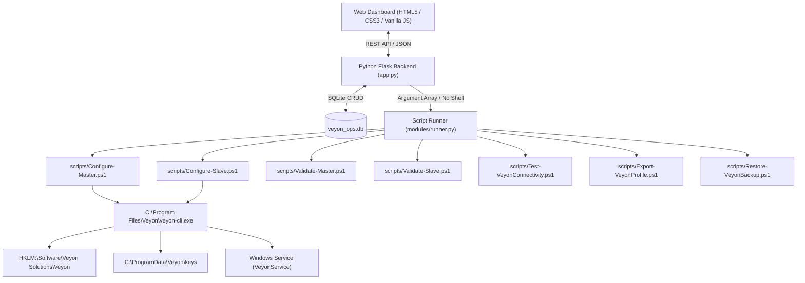

# VEYON OPS — Enterprise Master/Slave Auto-Configuration Platform

A professional cybersecurity-styled administration platform for configuring, pairing, validating, and monitoring **Veyon Master (Teacher)** and **Veyon Slave (Student)** deployments across Windows networks.

---

## 1. Platform Architecture & Tech Stack



- **Frontend**: Dark cybersecurity UI (Dark Navy `#0a0f1d`, Cyan `#00e5ff`, Emerald `#10b981`), zero external dependencies, responsive layouts, modular modal dialogs, and real-time execution terminals.
- **Backend**: Python 3.11 with Flask 3.1.3 providing RESTful endpoints, persistent SQLite storage (`veyon_ops.db`), strict parameter sanitization, and whitelisted PowerShell subprocess invocation (never `shell=True`).
- **PowerShell Automation Engine** (`scripts/`):
  - `Configure-Master.ps1`: Automated Master configuration with pre-change backup, keypair generation, firewall exceptions, classroom registration, and service startup.
  - `Configure-Slave.ps1`: Automated Slave configuration with public key import, Software SAS policy enforcement, and automatic purging of any unauthorized private keys.
  - `Validate-Master.ps1`: 10-point Master health and security audit with `-JsonOutput` support.
  - `Validate-Slave.ps1`: 8-point Slave security audit strictly verifying private key isolation.
  - `Test-VeyonConnectivity.ps1`: Socket probe and ping tester returning explicit states.
  - `Export-VeyonProfile.ps1`: Exports live HKLM Veyon configuration to timestamped JSON in `config/backups/`.
  - `Restore-VeyonBackup.ps1`: Safely restores JSON configuration with pre-restore safety snapshots.

---

## 2. Dashboard Pages

1. **Overview**:
   - Hostname, Windows username, elevation check (`IsUserAnAdmin`).
   - Detected Veyon version and executable path.
   - Live VeyonService state and Port 11100 listener check.
   - Registered Slaves count and live reachability summary.
   - Quick action triggers (Run Setup, Health Check, Restart Service, Export Public Key).
   - Recent audit log activity timeline.

2. **Master Configuration**:
   - Key pair name configuration (e.g., `teacher`).
   - Classroom location name (e.g., `Default Classroom`).
   - Target student client host registration.
   - Profile selection (`master`, `slave`, `unified`).
   - Overwrite protection with confirmation.
   - Real-time terminal log viewer streaming PowerShell execution.
   - Export Public Key button (only public keys can be downloaded).

3. **Slave Management**:
   - Registered student inventory table synced with SQLite and `BuiltinDirectory`.
   - Real-time network and port 11100 probing with explicit states:
     - `CONNECTED`: Host reachable via ICMP and port 11100 listening.
     - `PORT_OPEN_PING_BLOCKED`: Veyon service listening, but ICMP dropped by firewall.
     - `PING_REPLIED_PORT_CLOSED`: Host responds to ping, but Veyon service is stopped.
     - `DISCONNECTED`: Host unreachable.
     - `CHECK FAILED`: Hostname format invalid or contains metacharacters.
   - Add/Remove client computers with input sanitization.
   - Deployment options:
     - **Local Client Setup**: Generates one-command installation string.
     - **Remote Client Setup**: Probes WinRM (TCP 5985) and requires administrator credentials.

4. **Configuration Profiles (JSON Editor & Diff Engine)**:
   - Live multi-profile editor for `veyon-master.json`, `veyon-slave.json`, and `veyon-unified.json`.
   - Real-time syntax and schema validator.
   - Unified diff viewer showing exact line-by-line differences before saving.
   - Automatic pre-save backups saved to `config/backups/` and registered in SQLite.

5. **AGY Task Center**:
   - Transparent inspection of local `agy.exe` and background daemon.
   - Genuine HTTP status reporting: if AGY remote API returns HTTP 401 Unauthorized or is unconfigured, displays clear unauthenticated status without faking AI responses.
   - Whitelisted local task execution (`master_reconfigure`, `audit_slave_security`, `verify_all`).

6. **Diagnostics (10-Point System Health Check)**:
   1. Operating System & Architecture.
   2. Administrator / Elevation Rights.
   3. Veyon Installation & Core Binaries.
   4. Supported CLI Modules (`config`, `authkeys`, `service`, `networkobjects`).
   5. Windows Service (`VeyonService`) registration and running state.
   6. Port 11100 Local Socket Listener.
   7. Windows Defender Firewall Exceptions.
   8. Authentication Key Pair Presence & Isolation.
   9. Windows Software SAS (`SoftwareSASEnabled = 1`) Registry Policy.
   10. Backend Engine & SQLite Database Integrity.

7. **Audit Logs**:
   - Complete audit trail of script executions, client modifications, and configuration changes.
   - Category filtering (`ALL`, `INFO`, `EXEC`, `WARN`, `ERROR`).
   - Search by operation, computer, or username.

---

## 3. Quick Start & Execution Modes

### Mode A: One-Command PowerShell Setup (No GUI)

Open **Windows PowerShell as Administrator**:

```powershell
# Setup Master PC (generates keys, configures firewall, starts service)
.\install.ps1 -Role Master

# Setup Master with custom classroom name
.\install.ps1 -Role Master -RoomName "Computer Lab 101"

# Setup Slave PC (requires Master public key)
.\install.ps1 -Role Slave -PublicKeyPath "\\master\keys\teacher_public_key.pem"
```

### Mode B: Web Administration Dashboard

From the root directory:

```powershell
# Launch Dashboard (opens browser to http://127.0.0.1:5000)
.\start-dashboard.ps1

# Or specify a custom port without auto-opening browser
.\start-dashboard.ps1 -Port 8080 -NoBrowser
```

Or run directly via Python:

```powershell
cd dashboard
python -m pip install -r requirements.txt
python app.py
```

---

## 4. Security & Safety Model

1. **No Arbitrary Shell Execution**: The backend exposes zero endpoints for executing raw shell commands. All tasks execute via `modules/runner.py` with separate argument arrays passed to `subprocess.run(..., shell=False)`.
2. **Private Key Isolation**: Slaves are strictly forbidden from holding private keys. `Configure-Slave.ps1` and `Validate-Slave.ps1` actively detect and purge private keys.
3. **No Secret Leaks**: `/api/keys/public` only serves public keys (`*.public_key.pem`). Private keys are stored in `config/keys/` and ignored by Git.
4. **Input Sanitization**: Hostnames, IP addresses, and key names are checked against strict regexes (`^[a-zA-Z0-9_\-\.]+$`) and rejected if shell metacharacters (`;`, `&`, `|`, `` ` ``, `$`, quotes, spaces) are present.
5. **Pre-Change Backups**: Both GUI profile saves and CLI configuration runs create timestamped JSON snapshots in `config/backups/`.

---

## 5. Automated Test Suite

Run the automated test suite with pytest:

```powershell
python -m pytest dashboard/tests -v
```

All 28 tests covering validation, database operations, security headers, profile diffing, diagnostic structure, and API endpoints run and pass with a 100% pass rate.
